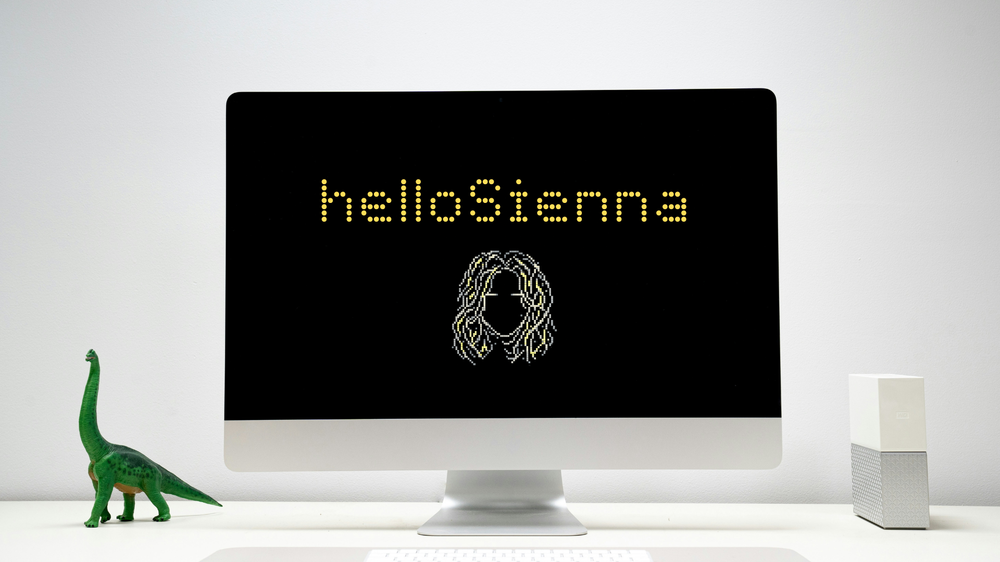

<p align="center">
  
</p>

<h1 align="center">HelloSienna</h1>

<p align="center">
  <strong>A voice for your digital world.</strong>
  <br>
  An experimental, voice-activated Windows desktop assistant built on OpenJarvis.
</p>

## Overview

HelloSienna is an experimental proof of concept using the OpenJarvis voice and desktop
automation engine. **Sienna** is the assistant's conversational identity. The current
activation phrase remains **"Hey Jarvis"** because the installed wake-word model is trained
for that phrase. **"HelloSienna" is a planned future activation phrase** and is not supported
until a compatible wake-word model has been trained and tested.

The assistant captures speech, transcribes it, uses an LLM to select desktop tools, applies
the configured safety policy, and speaks its response. The existing OpenJarvis package,
CLI commands, and configuration identifiers are retained.

HelloSienna is based on [OpenJarvis](https://github.com/LiaqatEagle/OpenJarvis), an MIT
licensed open-source project. This proof of concept is maintained at
[sabby13/sos](https://github.com/sabby13/sos).

## Current Features

- Voice activation with the existing local openWakeWord "Hey Jarvis" model.
- Microphone capture with voice activity detection and speech transcription.
- Groq and OpenAI-compatible LLM and transcription providers.
- General-purpose application launching, window controls, file search, and file operations.
- Browser opening and web search.
- Text-to-speech with Edge neural voices and an offline system-voice fallback.
- Safety checks for desktop and file actions.

Application launching uses installed-app discovery and aliases. Spotify, YouTube, and the
Windows Camera app depend on the app or browser being installed and available on the computer.
The project does not contain dedicated Spotify, YouTube, or camera integrations.

## Architecture

```text
"Hey Jarvis" -> openWakeWord -> microphone capture and VAD -> speech transcription
     -> Sienna agent and LLM -> safety policy -> desktop and browser tools
     -> spoken response
```

The wake-word model runs locally. Groq Whisper is the default transcription model, Groq is
the default LLM provider, and Edge neural TTS is the default speech output. OpenAI-compatible
provider settings are available as alternatives. Desktop operations are routed through
platform adapters and the general-purpose tool registry.

## Installation

### Windows setup

Install Python 3.10 or later, clone this repository, and run the setup script:

```bat
git clone https://github.com/sabby13/sos.git
cd sos
setup.bat
```

`setup.bat` creates `.venv`, installs the voice dependencies, creates `.env` from
`.env.example` if needed, and runs the setup diagnostics. Add a provider API key to `.env`
when prompted. For Groq, use `GROQ_API_KEY`; for OpenAI, use `OPENAI_API_KEY`.

Start voice mode with `jarvis.bat`. It also forwards CLI commands:

```bat
jarvis.bat doctor
jarvis.bat voice -k
jarvis.bat chat
jarvis.bat ask "open my downloads folder"
```

### Manual installation

From the repository directory, install the voice extras into a virtual environment:

```powershell
python -m venv .venv
.\.venv\Scripts\python.exe -m pip install -e ".[voice]"
if (-not (Test-Path .env)) { Copy-Item .env.example .env }
```

Add the provider key to `.env`, then run `jarvis.bat doctor` and `jarvis.bat` to start voice
mode. The voice extras include microphone capture, openWakeWord, and speech synthesis.

### Diagnostics

```bat
jarvis.bat doctor
jarvis.bat mic
jarvis.bat tools
jarvis.bat models
jarvis.bat devices
jarvis.bat voices
jarvis.bat config init
```

If the wake word never fires, check the microphone first. `jarvis.bat mic` displays input
levels; `jarvis.bat devices` lists available microphones. Windows may select an inactive
default input. Set `speech.input_device` in the configuration if needed.

The default Groq LLM is `openai/gpt-oss-120b`. Tool-calling reliability is important because
the assistant relies on model-generated function calls to operate desktop tools. Use
`jarvis.bat models` to see models available to your configured provider.

## Configuration

`jarvis config init` creates `~/.openjarvis/config.yaml`. Configuration precedence is
defaults, YAML, environment variables (including `.env`), then CLI overrides. API keys
belong in environment variables or `.env`, not in the YAML configuration.

```yaml
llm:
  provider: groq
  model: openai/gpt-oss-120b
  max_steps: 12
  max_tokens: 1024
  history_turns: 20
  rate_limit_max_wait_s: 8

speech:
  wake_word: hey_jarvis
  wake_threshold: 0.5
  input_device: null
  stt_provider: groq
  tts_engine: edge
  tts_voice: en-GB-SoniaNeural
  tts_rate_pct: 0
  tts_fallback: system
  silence_ms: 900
  vad_sensitivity: 2.5
  followup_window_s: 8.0

tools:
  app_aliases:
    music: spotify
```

For this prototype, the Edge TTS voice is **Sonia** (`en-GB-SoniaNeural`), with the
default natural speaking rate. Override `speech.tts_voice` in YAML or set
`OPENJARVIS_TTS_VOICE` in `.env`. The configured voice applies to the selected TTS engine;
the existing offline system-voice fallback remains enabled. Check availability with
`jarvis.bat voices --prefix en-GB`; Edge TTS catalog availability may change.

The existing wake-word setting accepts supported built-in model names or a path to a
compatible custom ONNX model. Setting it to `HelloSienna` alone does not create or train a
HelloSienna detector. Use `jarvis models` to list models available to the configured
provider, and `jarvis devices` to list microphone inputs.

For experimental voice sessions with short commands, try `history_turns: 6` to `8` and
`max_tokens: 512` to reduce request context and reserved output capacity. These are
configuration choices, not new defaults; use larger values for complex tasks that need
more conversation context or longer responses. For example:

```yaml
llm:
  history_turns: 6
  max_tokens: 512
  rate_limit_max_wait_s: 8
```

`rate_limit_max_wait_s` bounds total automatic retry waiting for rate limits (default 8
seconds, maximum 30); a request that needs longer is stopped with a clear error rather than
sleeping through a long quota reset. Set `OPENJARVIS_RATE_LIMIT_MAX_WAIT_S` to configure
the same wait budget from the environment.

With `--verbose` debug logging enabled, successful provider responses may report actual
prompt and completion token usage when the provider supplies it. These diagnostics do not
log keys, transcripts, prompts, or tool arguments; they are usage metadata, not estimates
from the requested token limit.

### Safety

Every tool declares a risk tier:

| Tier | Meaning | Default behaviour |
|---|---|---|
| `safe` | Observes only — list, search, read | Runs silently |
| `caution` | Reversible change — mkdir, rename, launch | Runs, printed to the console |
| `dangerous` | Destroys or executes — delete, overwrite | **Asks you first**, by voice or keyboard |

Additional protections include:

- Deletes go to the Recycle Bin unless permanent deletion is explicitly requested.
- System paths such as `C:\Windows`, Program Files, and drive roots are blocked.
- `safety.allowed_roots` can confine file writes to selected folders.
- `--dry-run` declines every confirmation so you can inspect a plan without executing it.

For example:

```yaml
safety:
  mode: tiered
  allowed_roots:
    - ~/Documents
    - ~/Projects
  always_confirm: [launch_application]
  protect_system_paths: true
```

## Example Voice Commands

Use the current activation phrase:

- "Hey Jarvis, open Spotify."
- "Hey Jarvis, play some music."
- "Hey Jarvis, open YouTube."
- "Hey Jarvis, open my camera."
- "Hey Jarvis, find my latest PDF."
- "Hey Jarvis, what do I have open?"

Commands depend on installed applications, provider availability, and the configured safety
policy. After a response, voice mode listens for follow-up commands for eight seconds without
requiring the wake phrase. Say "stop" to stop listening.

## Roadmap

Planned work, not current functionality:

- Train and evaluate a compatible **HelloSienna** wake-word model.
- Improve handling of provider rate limits and usage constraints.
- Add browser automation and screenshot/vision capabilities.
- Add interruptible speech output.
- Explore local LLM support and bring other platform adapters closer to Windows parity.
- Add terminal and Git tools behind the dangerous safety tier.

## Adding a tool

Tools are a Pydantic model plus a `run` method. Their docstrings describe the tool to the
model when it decides whether to call it.

```python
from pydantic import BaseModel, Field
from openjarvis.tools.base import RiskLevel, Tool, ToolContext, ToolResult


class SetVolumeArgs(BaseModel):
    level: int = Field(ge=0, le=100, description="Volume percentage.")


class SetVolume(Tool[SetVolumeArgs]):
    name = "set_volume"
    description = "Set the system output volume, 0 to 100."
    risk = RiskLevel.CAUTION
    args_model = SetVolumeArgs

    def run(self, args: SetVolumeArgs, ctx: ToolContext) -> ToolResult:
        ctx.platform.set_volume(args.level)
        return ToolResult.success(f"Volume set to {args.level} percent.")
```

Register the tool in `tools/registry.py` to inherit schema generation, argument validation,
safety tiering, and error handling. Tool descriptions should explain when to choose a tool.
Return `ToolResult.failure` for recoverable tool errors so the model can see and respond to
them.

## Contributing

Issues and pull requests are welcome. Useful interfaces to start with:

| File | What it defines |
|---|---|
| `tools/base.py` | The tool contract |
| `platforms/base.py` | Everything an OS adapter must implement |
| `safety/policy.py` | How risk tiers become decisions |
| `agent/loop.py` | The tool-calling loop |
| `llm/base.py` | The provider interface |

```bash
pip install -e ".[dev,voice]"
pytest
ruff check src tests
```

## License

MIT. See [LICENSE](LICENSE).
